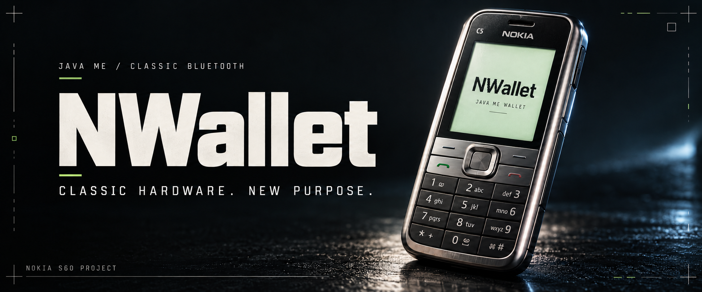

<p align="center">
  <code>JAVA ME</code> · <code>CLASSIC BLUETOOTH</code> · <code>PHYSICAL KEYS</code>
</p>

# NWallet · Nokia Wallet

**让经典设备，承担新的角色。**

> Old keys. New ideas. Explicit consent.

```text
┌─ NWALLET / SYSTEM PROFILE ──────────────────┐
│ TARGET   Nokia S60                          │
│ RUNTIME  Java ME · CLDC 1.1 / MIDP 2.0      │
│ LINK     Classic Bluetooth / RFCOMM         │
│ CONTROL  Physical keys. Explicit review.    │
│ MODE     DEVELOPMENT                        │
└─────────────────────────────────────────────┘
```

<sub>封面为概念视觉；实际功能与验证范围以下文为准。</sub>

NWallet 是面向 **诺基亚 S60 系列手机**的 Java ME 钱包项目。通过实体按键确认、电脑网页和 macOS 经典蓝牙桥接，完成助记词选择、钱包打开与地址核对。项目以 S60 系列为适配目标，不限定单一机型。

> 项目正在开发中。任意助记词导入、可信随机生成及生产级密钥保护尚未完成；交易签名、广播、余额和代币查询也未实现。请勿用于存储或管理真实资产。

## 如何工作


手机选择12／24词助记词；网页添加钱包并输入附加口令（passphrase）。手机完整展示内容，用户确认后实际派生 BTC、ETH、SOL 地址，网页校验结果后加密保存记录。打开钱包不批准交易。

客户端与手机各自承担不同职责：网页负责钱包列表、备注、加密存储和阅后即焚；手机负责本次连接授权、内容确认、地址派生和内存缓存。手机无需显示余额或维护持久钱包列表。

## 功能状态

| 功能 | 状态与范围 |
| --- | --- |
| 手机界面 | N-Gage 风格 Canvas，中英文，实体方向键与软键操作 |
| 手机应用锁 | 数字 PIN 设置、确认与锁定；不等同于生产级密钥保护 |
| 助记词 | 12／24词助记词选择流程；任意导入与可信随机生成待完善 |
| 钱包添加／打开 | 网页输入、手机确认、实际派生、地址回传与核对 |
| 缓存与取消 | 完整缓存查询、同请求结果重取、协作取消、地址不匹配保护 |
| 本地钱包库 | 长密码加密、备注、删除、每钱包阅后即焚 |
| 网页会话 | 闲置15分钟锁定，时限内同标签页刷新恢复 |
| Touch ID | 可选便捷解锁接口，保留长密码；具体硬件行为待本机验证 |
| 链上查询 | 尚未实现 |
| 交易签名／广播 | 尚未实现 |

## Monorepo 结构

```text
web/          Next.js 网页客户端、本地 API、加密钱包库
mac-bridge/   Swift macOS 经典蓝牙桥接与可选 Touch ID 接口
signer/       Java ME 手机钱包端、地址派生、Canvas 界面与测试
  src/        应用源码
  stubs/      编译用 API 声明，不打包进应用
  vendor/     固定版本的第三方源文件及许可证
  tools/      独立构建与依赖校验脚本
  deps.lock   构建依赖 URL 与 SHA256
  tests/      离线控制器、协议、输入和界面检查
tools/        本地启动辅助及发布文件检查
docs/public/  架构、构建、操作和第三方说明
```

三个运行组件由同一个 Git 仓库管理，无需相邻研究项目或 Git 子模块。npm 依赖在 `web/` 安装，Java 与 Swift 使用各自原生工具链。

## 快速开始

### 环境

- 网页：Node.js **20.9.0及以上**、npm。
- 完整电脑客户端：macOS、Xcode Command Line Tools、Python 3；经典蓝牙由原生桥接提供，不是 Web Bluetooth。
- 手机构建：JDK（`java`／`javac`）、Python 3、make；首次构建需下载锁定的依赖。
- 手机目标：**Nokia S60 系列**，运行环境需要 Java ME CLDC 1.1／MIDP 2.0，并支持 JSR-82 经典蓝牙 API。不同 S60 版本与机型的字体、按键、权限和蓝牙行为仍需逐机验证；项目面向整个系列，不表示所有型号已通过测试。

### 获取源码与启动网页

```sh
git clone https://github.com/LidamaoHub/Nokia-Wallet.git
cd Nokia-Wallet
npm --prefix web ci
npm --prefix web run dev
```

访问 **http://127.0.0.1:3018/**。该命令只启动网页，完整蓝牙操作还需要 Mac 桥接和本地模式。

### 启动完整 Mac 客户端

在仓库根目录双击 `启动钱包开发版.command`，或执行：

```sh
zsh ./启动钱包开发版.command
```

脚本会构建桥接与网页并开启本地模式。停止时使用 `停止钱包开发版.command`。原生桥接只进行本机 ad-hoc 签名，不是已公证的发行安装包。

### 构建手机端

```sh
python3 signer/tools/fetch-deps.py
make -C signer nwallet
```

手机版本为 **0.3.2**，安装文件位于：

```text
signer/dist/nwallet-0.3.2/NWallet.jar
signer/dist/nwallet-0.3.2/NWallet.jad
signer/dist/nwallet-0.3.2/SHA256SUMS
```

依赖下载至本项目 `.deps/`，按锁文件校验 SHA256；构建产物不进入源码仓库。打包拒绝覆盖已有同版本 JAR，重新打包前需明确归档或使用新版本号。

## 第一次体验

1. 在手机安装 JAR，设置并重复确认 PIN。
2. 手机“设置 → 选择助记词”，上下选择12／24词，右软键选用。
3. 首页开启蓝牙服务，在网页手工选择设备连接，再在手机允许本次连接。
4. 网页点击“添加”，输入备注及附加口令（passphrase）；空串有效，大小写与首尾空格保留。
5. 手机上下查阅，左软键拒绝、右软键确认；派生过程中左软键可请求取消。
6. 网页核对实际三链地址后保存。已有记录缓存命中时，不再发送 passphrase。

具体操作和生命周期见 [手机操作](docs/public/PHONE.md)。

## 离线检查

```sh
npm --prefix web test
npm --prefix web run build
npm --prefix web run typecheck
make -C signer test test-radio test-consent test-wallet-flow test-ui
```

手机检查需先完成构建。测试使用公开夹具、内存传输和桌面字体适配器；不自动配对、连接或操作真实手机。更多原生桥接和跨实现检查见 [构建与测试](docs/public/BUILD.md)。

## 边界与部署方式

- 当前为开发版本，助记词管理与密钥保护能力仍待完善，不能用于真实资产。
- 完整连接依赖本机 macOS 桥接。把网页部署到静态托管或公网服务，不能直接替代本地客户端；不要在公网启用本地 API 模式。
- 每次新连接仍需手机明确授权。CRC、请求 UUID 和应用确认不等于密码学身份认证或防劫持保证。
- 离线协议检查、桌面 Canvas 截图和编译结果不能替代 Nokia 真机、真实蓝牙或 Touch ID 验收。
- 应用 PIN、运行时内存释放和持久化逻辑删除不构成真实根密钥保护或取证级擦除保证。

## 文档与许可

- [架构与协议](docs/public/ARCHITECTURE.md)
- [构建与测试](docs/public/BUILD.md)
- [手机操作](docs/public/PHONE.md)
- [第三方来源与许可](docs/public/THIRD_PARTY.md)

第三方源文件保留上游版权及许可证；本仓库尚未指定原创代码的开源许可证。

---

<p align="center">
  <code>LESS TOUCHSCREEN. MORE TACTILE.</code><br>
  <sub>经典按键，新用途。每次确认，都有明确的动作。</sub>
</p>
